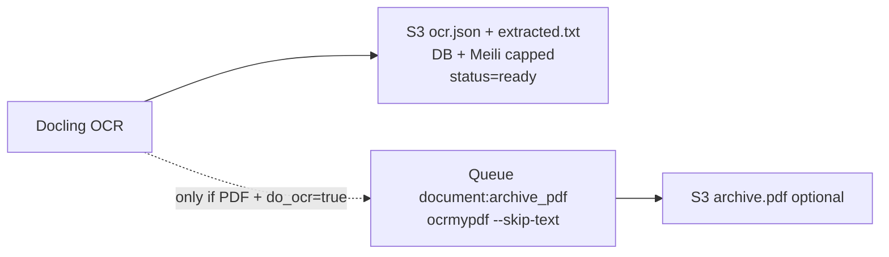
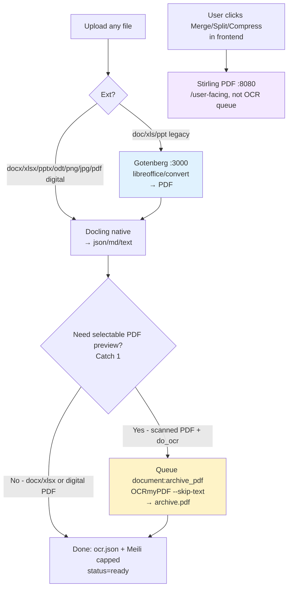

# Docling OCR — Paperless Replacement for EDMS

> **S3 is the store · Asynq is the queue · Docling is the engine · JSON is the contract**
> Drop Paperless's second DMS + durable local disk — handle _every office file_ as a stateless `file → JSON + optional PDF` job.

---

## Contents

1. [GPU required?](#tldr--do-you-need-a-gpu)
2. [Why Docling replaces Paperless](#why-docling-replaces-paperless)
3. [What Docling handles](#what-docling-handles-natively)
4. [Docker Compose](#docker-compose--copypaste)
5. [Integration into this codebase](#integration-into-this-codebase)
6. [Resolving the 4 catches efficiently](#resolving-the-4-catches-efficiently) ← _you asked about these_
7. [StirlingPDF vs OCRmyPDF vs Gotenberg](#stirlingpdf-vs-ocrmypdf-vs-gotenberg--which-belongs-in-the-ocr-pipeline)
8. [Scaling & queues](#scaling--queues)
9. [Migration checklist](#migration-checklist)

---

## TL;DR — Do you need a GPU?

**No. CPU-only Docker Compose is the default.** GPU just makes it faster.

| Mode | Image | 10-page scanned PDF + tables | Use when |
|------|-------|------------------------------|----------|
| **CPU** | `ghcr.io/docling-project/docling-serve:latest` | 15–40s | Day 1. `docx/xlsx/pptx`, digital PDFs, light scans. |
| **GPU NVIDIA CUDA 12.8/13.0** | `ghcr.io/docling-project/docling-serve-cu128` / `-cu130` | 3–8s (4–10×) | Heavy scans, `table_mode=accurate`, VLM `granite_docling`. Add 1 worker later. |
| **GPU AMD ROCm** | `make docling-serve-rocm-image` | similar | AMD hosts |

Default pipeline = `layout + RapidOCR/Tesseract + TableFormer` — all run on CPU. GPU accelerates layout/table/VLM, not plain OCR text.

> `DOCLING_SERVE_LOAD_MODELS_AT_BOOT=true` + `DOCLING_SERVE_ARTIFACTS_PATH=/tmp/docling-artifacts` on a volume — otherwise first request cold-starts and downloads models.

**Start CPU ×2 workers. Add GPU only when `p50 poll >30s` or you enable VLM picture description.**

---

## Why Docling replaces Paperless

Previous Paperless path (`backend/internal/service/ocr.go`, removed `backend/internal/paperless/client.go`):

```
S3/local/SharePoint → Asynq download → Upload to Paperless → local media/DB → poll 60×2s → Download archive → Upload S3 → document_extractions + Meili
```

You only use `Content` + `archive.pdf` + `title`. Dedupe already exists via `checksum` in `backend/internal/service/document.go:102` — Paperless duplicate-id parsing is redundant.

Target:

```mermaid
flowchart LR
  U[POST /documents] --> S[S3 documents/{id}/original.*]
  S --> Q[Asynq document:ocr]
  Q --> W[Go thin poller]
  W -->|POST /v1/convert/file/async| D[Docling API 5001]
  D --> RQ[(Redis RQ)]
  RQ --> W1[Worker CPU 1]
  RQ --> W2[Worker CPU 2]
  RQ -.-> WG[Worker GPU optional]
  W1 -->|GET /v1/status/poll + /v1/result| W
  W --> S3J[S3 ocr.json + extracted.txt + archive.pdf?]
  W --> DB[(SurrealDB document_extractions)]
  W --> MEILI[Meilisearch]
```

*No second store. No durable local copy. S3 in → S3 out. Docling is a processor, not a DMS.*

---

## What Docling handles natively

Source: `docling-project.github.io/docling/usage/supported_formats/`

| Input | Notes | OCR? |
|-------|-------|------|
| `PDF` digital + scanned | Layout, reading order, tables | `do_ocr` auto |
| `DOCX`, `XLSX`, `PPTX` | Office Open XML — **native**, no LibreOffice needed | extract |
| `DOC`, `XLS`, `PPT` | Legacy binary 97-2004 — needs LibreOffice convert | → see Catch 2 |
| `PNG`, `JPEG`, `TIFF`, `BMP`, `WEBP` | Images | OCR |
| `ODT/ODS/ODP`, `HTML`, `CSV`, `Markdown`, `AsciiDoc`, `EPUB` | | extract |
| `EML`, `MSG` | Email + attachment names | extract |

Unsupported → **fail fast** with `processing_jobs.last_error=unsupported_type` (`zip`, `CAD/DWG`, `video`, encrypted PDFs, `>MAX_NUM_PAGES`). Don't hang Asynq 10m.

Output you persist: `to_formats=[json, md, text, doctags]` → mapped to `document_extractions.Text` + `Metadata`.

---

## Docker Compose — copy/paste

### CPU + helpers (recommended default)

```yaml
services:
  redis:
    image: valkey/valkey:8

  docling-api:
    image: ghcr.io/docling-project/docling-serve:latest
    ports: ["5001:5001"]
    environment:
      DOCLING_SERVE_ENG_KIND: rq
      DOCLING_SERVE_ENG_RQ_REDIS_URL: redis://redis:6379/0
      DOCLING_SERVE_LOAD_MODELS_AT_BOOT: "true"
      DOCLING_SERVE_ARTIFACTS_PATH: /tmp/docling-artifacts
      DOCLING_SERVE_MAX_FILE_SIZE: "100MB"
      DOCLING_SERVE_MAX_NUM_PAGES: "200"
      DOCLING_SERVE_DOCUMENT_TIMEOUT: "600"
      DOCLING_SERVE_ENABLE_REMOTE_SERVICES: "true" # for external AI, Catch 3
    volumes: [docling-cache:/tmp/docling-artifacts]
    depends_on: [redis]

  docling-worker:
    image: ghcr.io/docling-project/docling-serve:latest
    command: ["docling-serve", "worker"]
    environment:
      DOCLING_SERVE_ENG_KIND: rq
      DOCLING_SERVE_ENG_RQ_REDIS_URL: redis://redis:6379/0
      DOCLING_SERVE_ARTIFACTS_PATH: /tmp/docling-artifacts
    volumes: [docling-cache:/tmp/docling-artifacts]
    depends_on: [docling-api, redis]
    deploy: { replicas: 2 } # scale THIS, not the Go API
    # resources: { limits: { memory: 8G, cpus: "2" } }

  # Catch 2: only needed for legacy .doc/.xls/.ppt (5% of office files)
  gotenberg:
    image: gotenberg/gotenberg:8
    command: ["gotenberg", "--api-port=3000"]

  # Catch 1: only if you must serve a selectable PDF preview
  ocrmypdf:
    image: jbarlow83/ocrmypdf:latest
    entrypoint: ["ocrmypdf"] # called via Go worker, or as sidecar CLI

  api:
    build: ./backend
    environment:
      DOCLING_BASE_URL: http://docling-api:5001
      GOTENBERG_BASE_URL: http://gotenberg:3000
      S3_BUCKET: ${S3_BUCKET}
      REDIS_URL: redis://redis:6379/0
      XAI_API_KEY: ${XAI_API_KEY} # for Catch 3 remote VLM
    depends_on: [docling-api, redis]

volumes: { docling-cache: }
```

### GPU worker (add later, side-by-side with CPU workers)

```yaml
  docling-worker-gpu:
    image: ghcr.io/docling-project/docling-serve-cu128:latest
    runtime: nvidia # requires nvidia-container-toolkit, drivers >=550
    environment:
      DOCLING_SERVE_ENG_KIND: rq
      DOCLING_SERVE_ENG_RQ_REDIS_URL: redis://redis:6379/0
    deploy:
      resources:
        reservations: { devices: [{ driver: nvidia, count: 1, capabilities: [gpu] }] }
```

---

## Integration into this codebase

### 1. Config — `backend/internal/config/config.go:56`

```go
type DoclingConfig struct {
  BaseURL string        // DOCLING_BASE_URL=http://docling-api:5001
  APIKey  string        // DOCLING_API_KEY
  Timeout time.Duration // 600s
}
type OCRConfig struct {
  Provider  string // "docling"
  Docling   DoclingConfig
  Gotenberg string // GOTENBERG_BASE_URL for Catch 2
}
```

`.env.example` diff: delete `PAPERLESS_BASE_URL:33`, add

```
DOCLING_BASE_URL=http://docling-api:5001
DOCLING_API_KEY=
DOCLING_TIMEOUT=600s
GOTENBERG_BASE_URL=http://gotenberg:3000
```

### 2. New `backend/internal/docling/client.go` ✅

```go
type Client struct{ baseURL string; http *http.Client }

func (c *Client) ConvertFileAsync(ctx context.Context, filename string, r io.Reader, opts Options) (taskID string, err error)
// POST /v1/convert/file/async  multipart: files + to_formats=json,md,text + do_ocr=true + table_mode=accurate

func (c *Client) ConvertSourceAsync(ctx context.Context, presignedURL string, opts Options) (string, error)
// POST /v1/convert/source/async { "http_sources": [{"url": presignedURL}] } — preferred for S3 to avoid proxying 100MB

func (c *Client) Poll(ctx context.Context, taskID string) (*TaskStatus, error)  // GET /v1/status/poll/{id}
func (c *Client) Result(ctx context.Context, taskID string) (*ConvertResult, error) // GET /v1/result/{id}

type ConvertResult struct {
  TextContent string         // text
  MdContent   string         // markdown
  JsonContent map[string]any // full DoclingDocument
  RawJSON     []byte         // store as ocr.json
  Pages       int
  Status      string
  Timings     map[string]float64
}
```

Always use **async** (`/async` + `poll` + `result`). Sync `/v1/convert/file` holds the Asynq slot for minutes — same bug as `ocr.go:160 poll 60×2s`.

### 3. Refactor `backend/internal/service/ocr.go` ✅

```go
type OCRService struct {
  DB       *surrealdb.DB
  storage  storage.Provider
  docling  *docling.Client // was *paperless.Client
  search   *search.Client
  log      *slog.Logger
}
func (s *OCRService) ProcessOCR(ctx context.Context, documentID, storagePath string) error {
  // load doc, set DocumentStatusProcessing (keep existing)
  // presigned or Download → taskID := docling.ConvertFileAsync(...)
  // store taskID in processing_jobs.external_id
  // poll with backoff 2s→5s until success/failure
  // res := docling.Result(...)
  // s.storage.Upload(ctx, "documents/"+docID+"/ocr.json", ...)
  // s.completeDocument(ctx, doc, res.TextContent, res.MdContent, res.RawJSON)
}
```

Paperless helpers (`submitAndWait`, `waitForTask`, `DuplicateDocumentID`) have been removed.

### 4. Wire `backend/cmd/api/main.go` ✅

```go
var doclingClient *docling.Client
if cfg.OCR.Docling.BaseURL != "" {
  doclingClient = docling.New(cfg.OCR.Docling)
}
ocrSvc := service.NewOCRService(db.Client(), provider, doclingClient, searchClient, logger)
```

Removed `internal/paperless` + the `go.mod` dependency on `paperless-ngx.go`.

### 5. Queues — `backend/internal/queue/tasks.go:4`

Keep `TaskOCR = "document:ocr"` (`service/document.go:170` enqueues correctly). Add only if you need Catches 1/2 isolation:

```go
const TaskArchivePDF = "document:archive_pdf" // Catch 1
```

`ReOCR` (`handler/documents.go:44`) reuses same `document:ocr` path. Store `task_id` in `processing_jobs.external_id` (`ocr.go:123`) for tracing.

---

## Resolving the 4 catches efficiently

### Catch 1 — `Archive PDF ≠ search text`

**Confusion:** Paperless quietly produced *two* outputs: (a) searchable text for Meili/DB and (b) a PDF/A where the text layer is selectable in the browser preview. Docling produces only (a): `json/md/text`. The preview still works with the original PDF, but you can't select/highlight scanned text without a searchable PDF.

**Best fix — decouple, don't block indexing:**



* **Fast path (always, immediate):** After `docling.Result`, upload `ocr.json` + `extracted.txt`, write `document_extractions` + `Meili` (capped, see Catch 4), set `ready`. User can search/download *now*.
* **Slow path (only PDFs that were scanned):**
  ```go
  // after fast path
  if isPDF && !res.Meta["skipped_ocr"] {
    _ = s.queue.Enqueue(ctx, queue.TaskArchivePDF, ArchivePayload{DocumentID: docID, StoragePath: storagePath})
  }
  ```
  Worker: `storage.Download → ocrmypdf --skip-text input.pdf archive.pdf → storage.Upload("documents/{id}/archive.pdf")`. Frontend: `GET /documents/:id/download?variant=archive` falls back to `original` if archive not ready. No 2-min poll blocking search.

> Don't install `ocrmypdf` in Docling. Keep it as a tiny `jbarlow83/ocrmypdf` sidecar or in the Go worker image, only for this queue.

### Catch 2 — `Legacy .doc/.xls/.ppt need LibreOffice`

**Confusion:** Modern `docx/xlsx/pptx` are ZIP+XML — Docling parses natively (tables kept). Legacy `doc/xls/ppt` (97-2004) are binary — default Docling image can't open them. You'll accept them via `handler/documents.go:111` but the worker would fail.

**Best fix — Gotenberg pre-convert only for legacy, not a rebuild:**

Don't rebuild Docling with LibreOffice for 5% of files. Keep Docling slim and delegate:

```go
func (s *OCRService) toDoclingInput(ctx context.Context, filename string, r io.Reader) (string, io.Reader, error) {
  if isLegacyOffice(filename) { // .doc, .xls, .ppt, .dot, .xlt — not docx/xlsx/pptx
    pdf, err := s.gotenberg.Convert(ctx, filename, r) // POST http://gotenberg:3000/forms/libreoffice/convert
    if err != nil { return "", nil, fmt.Errorf("legacy office convert: %w", err) }
    return strings.TrimSuffix(filename, filepath.Ext(filename)) + ".pdf", bytes.NewReader(pdf), nil
  }
  return filename, r, nil // modern office → native Docling (fast, table structure preserved)
}
```

Now: `docx/xlsx/pptx` → native Docling (accurate tables, no conversion loss). `doc/xls/ppt` → Gotenberg → PDF → Docling (one extra hop only when needed). No custom Docling image to maintain.

### Catch 3 — `Can I use external AI for Docling?`

**Yes — via OpenAI-compatible remote API. Don't run local VLM on CPU.**

Docling supports `picture_description_api` + `vlm_pipeline_model_api` when `DOCLING_SERVE_ENABLE_REMOTE_SERVICES=true`. Your stack already has `XAI_API_KEY` + `XAI_BASE_URL=https://api.x.ai/v1` (`backend/.env.example:46`) — XAI is OpenAI-compatible, so point Docling at it.

**Best fix — remote VLM only for image-heavy docs, not every file:**

```go
opts := docling.Options{
  ToFormats: []string{"json","md","text"},
  DoOCR: true, TableMode: "accurate",
}
// Gate: only scans with figures, not every xlsx
if isScannedPDF(res) && hasImages(filename) {
  opts.DoPictureDescription = true
  opts.PictureDescriptionAPI = &docling.RemoteVLM{
    URL:     cfg.XAI.BaseURL + "/chat/completions", // https://api.x.ai/v1/chat/completions
    Headers: map[string]string{"Authorization": "Bearer " + cfg.XAI.APIKey},
    Params:  map[string]any{"model": cfg.XAI.ChatModel, "max_completion_tokens": 300},
  }
  // For full-page VLM pipeline (GraniteDocling) — heavier, use sparingly:
  // opts.VlmPipelineModelAPI = &docling.RemoteVLM{ URL: ..., Params: {"model":"grok-4"} }
}
```

* `describe pictures` = caption figures/charts inside PDFs (`docling-serve` docs `usage.md: picture_description_api`).
* `vlm_pipeline` = whole-page VLM conversion (`granite_docling`) — much slower/costlier, reserve for warped scans.

> Your existing `AI_ENABLE_EMBEDDINGS/LLM` classification (`internal/search` / `internal/service`) stays separate — that's EDMS taxonomy, not Docling vision. Don't conflate them.

Cost control: gate on `MimeType=image/*` or `Pages <5 && layout.hasPictures`, cap `max_completion_tokens`, and run CPU-only Docling otherwise.

### Catch 4 — `Meilisearch size — cap 100-200KB`

**Confusion:** Docling `text_content` for a 400-row `xlsx` or 200-page scan can be 2-5MB. Meili has a soft limit (~100KB per indexed field) and large `document_extractions.Text` bloats Surreal + slows `GET /documents?q=`. Paperless indexed uncapped `processed.Content` — you inherited that risk.

**Best fix — `S3 = truth, DB = preview, Meili = capped chunk`:**

```go
const maxIndexChars = 150_000 // ~150KB — tune to Meili payload

func cappedForIndex(s string) string {
  if len(s) <= maxIndexChars { return s }
  return s[:maxIndexChars] + "\n\n…[truncated — full text in S3 ocr.json]"
}

func (s *OCRService) completeDocument(ctx context.Context, doc *database.Document, res *docling.ConvertResult) {
  fullText := res.TextContent
  capped   := cappedForIndex(fullText)

  // 1. S3 — full truth (never truncated)
  _ = s.storage.Upload(ctx, "documents/"+doc.ID+"/ocr.json", bytes.NewReader(res.RawJSON))
  _ = s.storage.Upload(ctx, "documents/"+doc.ID+"/extracted.txt", strings.NewReader(fullText))

  // 2. SurrealDB — preview + pointer
  // model_document_extraction.go:8 — keep Text small, Metadata holds pointer
  _, _ = surrealdb.Create[database.DocumentExtraction](ctx, s.DB, "document_extractions", &database.DocumentExtraction{
    DocumentID: string(doc.ID),
    Text:       fullText[:min(50_000, len(fullText))],
    Pages:      res.Pages,
    Metadata: map[string]any{
      "engine": "docling", "markdown_preview": res.MdContent[:min(10_000, len(res.MdContent))],
      "full_text_s3": "s3://"+s.cfg.S3.Bucket+"/documents/"+doc.ID+"/ocr.json",
      "pages": res.Pages,
    },
  })

  // 3. Meili — capped (fast search, no payload error)
  _ = s.search.IndexDocument(ctx, search.Document{
    RecordID: string(doc.ID), OwnerID: doc.OwnerID,
    Name: doc.Name, Content: capped, Status: database.DocumentStatusReady,
  })
}
```

Result: search stays fast, `GET /documents/:id/ocr` shows the 50KB preview, `GET /documents/:id/download?variant=ocr.json` fetches the full truth from S3. Re-index never re-parses Docling.

---

## StirlingPDF vs OCRmyPDF vs Gotenberg — which belongs in the OCR pipeline?

They solve different steps. Use **two of them inside** the Docling pipeline, **one outside** for user tools.

| Tool | What it is | Queue-ready? | What it does well | What it doesn't do | Use in EDMS? |
|------|------------|--------------|-------------------|--------------------|--------------|
| **Gotenberg 8** | LibreOffice + Chromium + `uno` API (`gotenberg.dev`) | **Yes** — stateless `POST /forms/libreoffice/convert` → `PDF` | Convert **any office** (`docx/xlsx/pptx` + legacy `doc/xls/ppt`, `odt`, `html`) to PDF with high fidelity. One binary, no Python. | No OCR. No text extraction. No tables/layout. | **Yes — inside OCR pipeline for Catch 2 only** |
| **OCRmyPDF 16.x** | `tesseract` wrapper (`ocrmypdf.readthedocs.io`) | **Yes** — CLI `ocrmypdf --skip-text input.pdf output.pdf`, easy to queue | Take a **scanned PDF** and bake a **searchable PDF/A** text layer (select/copy/highlight). `lang=eng+swa`, deskew, clean. | No office parsing. No tables/layout/reading order. Weak on `docx/xlsx` directly. | **Yes — inside OCR pipeline for Catch 1 only** |
| **Stirling PDF** | Java + LibreOffice toolbox (UI with 100+ PDF tools) | **No** — built for interactive user actions (`/api/v1/convert`, merge/split/rotate/sign`) | Great for **user-facing PDF ops** your `frontend` already wants: merge, split, compress, add watermark, convert office→pdf on-demand. | Not a job engine: heavy JVM, no RQ, no polling/callbacks, image is ~800MB, stateful temp `pipeline/` dir (`stirlingpdf.com`). Bad fit to hide behind `document:ocr`. | **No — keep outside OCR pipeline** |

### Decision flow for your stack



### Recommended split (efficient, no overlap)

```
Docling pipeline (backend/internal/service/ocr.go — machine path, no UI):

  office modern     ────────────────→ Docling (native tables/layout)
  office legacy doc ──→ Gotenberg ──→ Docling
  scanned pdf/image ────────────────→ Docling (text) ──→ optional OCRmyPDF (archive.pdf)

User toolbox (frontend/app/components/* — human path, on demand):

  Merge / Split / Rotate / Compress / Watermark / Office→PDF preview button
  ───────────────────────────────→ Stirling PDF :8080  (separate deploy)
```

**Why not Stirling for OCR?** You'd be polling a UI service that wants to keep files in `pipeline/` and return a `uuid` for the next user click — the opposite of `S3 in → S3 out + JSON`. You also pay JVM + LibreOffice twice (Stirling **and** Docling would each bundle it) and lose RQ backpressure (`Gotenberg` + `OCRmyPDF` scale as tiny stateless workers; Stirling doesn't).

**Concrete Compose**

```yaml
# OCR pipeline — keep small, scale via RQ (Catch 1+2)
docling-api:   { image: ghcr.io/docling-project/docling-serve:latest }
docling-worker:{ image: ghcr.io/docling-project/docling-serve:latest, command: [docling-serve, worker] }
gotenberg:     { image: gotenberg/gotenberg:8, command: [gotenberg, --api-port=3000] }
ocrmypdf:      { image: jbarlow83/ocrmypdf:latest } # CLI only, no HTTP

# User toolbox — separate, optional, never in document:ocr queue
stirling-pdf:
  image: stilingaguy/stirling-pdf:latest
  ports: ["8080:8080"]
  environment: { DOCKER_ENABLE_SECURITY: "false", INSTALL_BOOK_AND_ADVANCED_HTML_OPS: "false" }
  # Frontend calls POST http://stirling-pdf:8080/api/v1/convert/* only on user action
```

### Quick picker

* **Need searchable PDF preview after OCR?** → `OCRmyPDF` in `document:archive_pdf` queue (one CLI call, `lang` from config, `S3 archive.pdf` fallback to `original.pdf`).
* **Need to handle `doc/xls/ppt` legacy uploads?** → `Gotenberg` pre-convert only for `isLegacyOffice()` branch (see Catch 2 code).
* **Need users to merge/split/compress PDFs themselves?** → `Stirling PDF` as a standalone tool at `http://stirling-pdf:8080`, called from `frontend` buttons, **never** from `Asynq document:ocr`.

> Keep the OCR path headless and queued (`Gotenberg` + `Docling` + `OCRmyPDF`). Keep Stirling headful for the UI. Don't make Stirling pretend to be an OCR worker — that's how you rebuild Paperless.

---

## Scaling & queues

* **Uploads** `handler/documents.go:111` → hash → S3 → `Enqueue(document:ocr)` → `201 processing` immediately. 50 uploads = 50 jobs, not 50 blocked HTTP.
* **Asynq concurrency:** Go worker only submits/polls — keep `QUEUE_CONCURRENCY_OCR=2` (today `QUEUE_CONCURRENCY=10` in `.env.example:14` is too high for OCR). Keep `QUEUE_CONCURRENCY_DEFAULT=10` for other tasks.
* **Docling RQ workers:** real parallelism. Start `2`, HPA on `RQ queue depth / started count`, not API CPU. OCR nodes separate from `api`.
* **Presigned S3:** Prefer `POST /v1/convert/source/async {"http_sources":[{"url": presignedGET}]}` so workers pull from S3. Fallback to `multipart /v1/convert/file/async` for `local`/`sharepoint` (`storage/provider.go:28` needs `GetUrl`/`Presign`).
* **WebSocket** `/v1/status/ws/{task_id}` exists, but poll `GET /v1/status/poll/{task_id}` with backoff 2s→5s is simpler inside Asynq retries.

Curl checks:

```bash
curl -X POST http://localhost:5001/v1/convert/file/async \
  -F "files=@invoice.pdf;type=application/pdf" \
  -F "to_formats=json" -F "to_formats=md" -F "to_formats=text" \
  -F "do_ocr=true" -F "table_mode=accurate" | jq

curl http://localhost:5001/v1/status/poll/<task_id> | jq
curl http://localhost:5001/v1/result/<task_id> | jq '.document.md_content'
```

---

## Migration checklist

- [x] Add `docling-api` + `docling-worker` + `gotenberg` to Compose (CPU start, GPU optional)
- [x] `backend/internal/docling` client + `config` swap (`DOCLING_BASE_URL`, remove `PAPERLESS_*`)
- [x] Refactor `service/ocr.go` to async Docling fast path + Gotenberg legacy Office branch
- [x] Add capped index/DB text + storage-backed `ocr.json`, `extracted.txt`, and `extracted.md` truth in `completeDocument`
- [ ] Split Asynq queues (`document:ocr` vs `document:archive_pdf` vs `search:reindex`)
- [ ] Test matrix: `pdf digital`, `pdf scanned`, `docx`, `xlsx` (200 rows), `pptx`, `jpg`, `doc` (legacy via Gotenberg), `eml`
- [ ] Compare `document_extractions.Text` on old docs → disable Paperless (keep `POST /documents/:id/redo-ocr` as retry)
- [ ] Enable remote VLM (`XAI`) only on flagged image-heavy docs, monitor cost/latency

> **Invariant stays:** `S3 is store, Asynq is queue, Docling is engine`. Bursts queue; no second DMS; search indexing never waits for a PDF render.

---

## References

* Docling Serve deployment (RQ, GPU): `docling-project/docling-serve/docs/deployment.md`
* Docling Serve usage (converts, callbacks): `docling-project/docling-serve/docs/usage.md`
* Docling supported formats: `docling-project.github.io/docling/usage/supported_formats/`
* Repo OCR path: `backend/internal/service/ocr.go`, `backend/internal/docling/client.go`, `backend/internal/queue/tasks.go:4`, `backend/internal/tasks/ocr.go:12`, `backend/internal/storage/provider.go:28`
